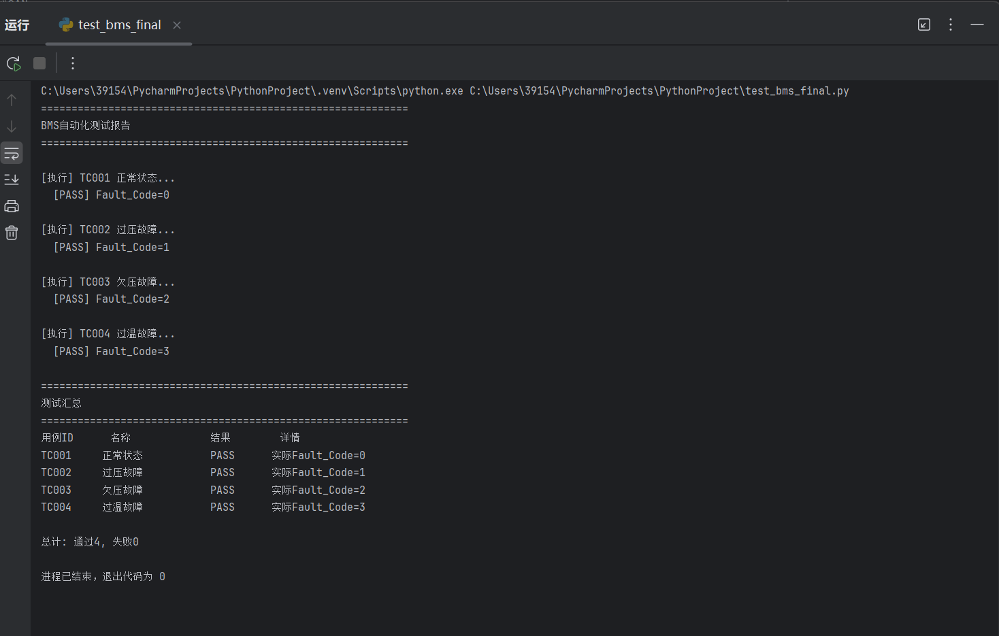
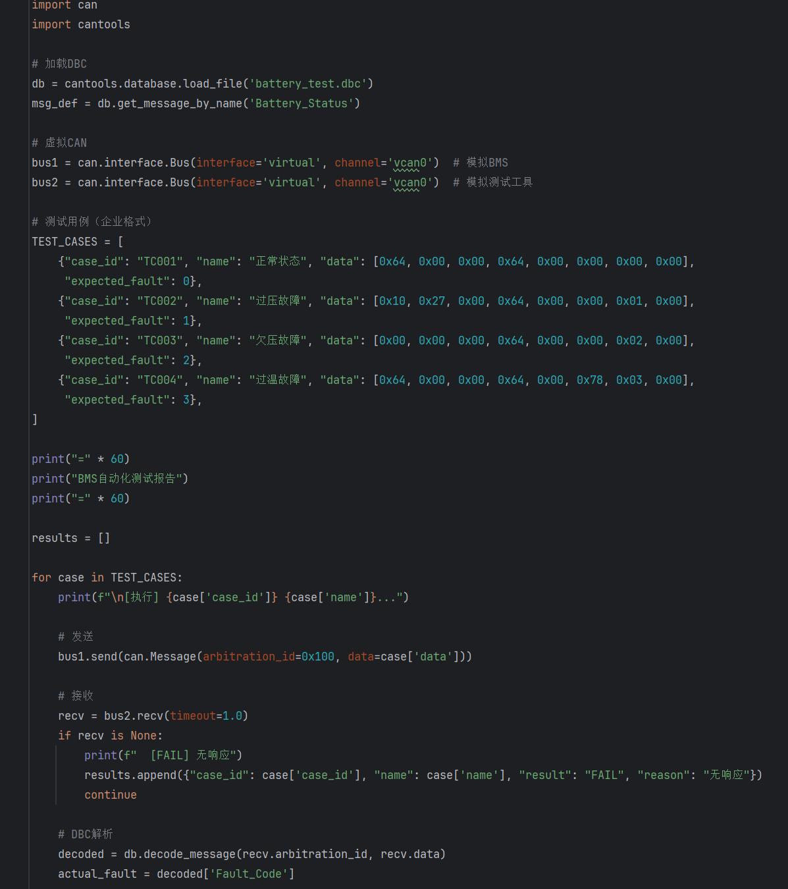

# BMS自动化测试项目

基于Python + python-can + cantools的BMS自动化测试脚本。

## 功能特性
- 虚拟CAN收发，无需硬件
- DBC文件解析CAN信号
- 4种故障场景测试（正常/过压/欠压/过温）
- 自动判定PASS/FAIL，输出测试报告

## 运行方法

```bash
pip install python-can cantools
python test_bms_final.py
```

## 测试报告截图




